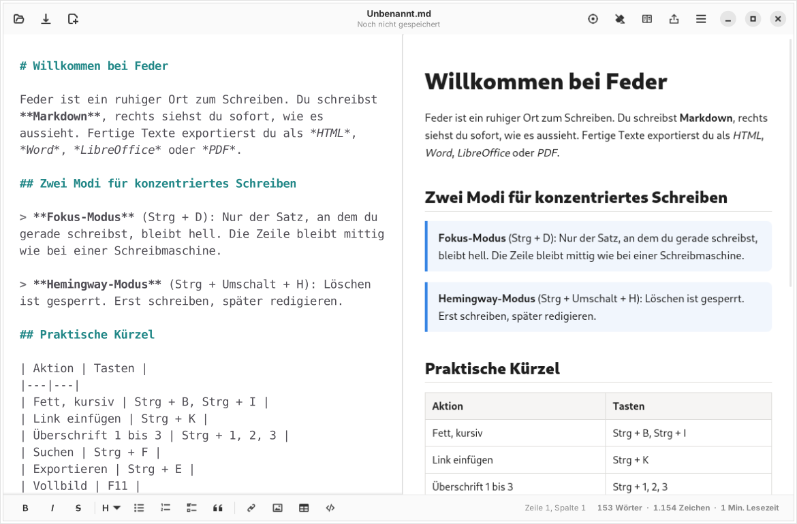
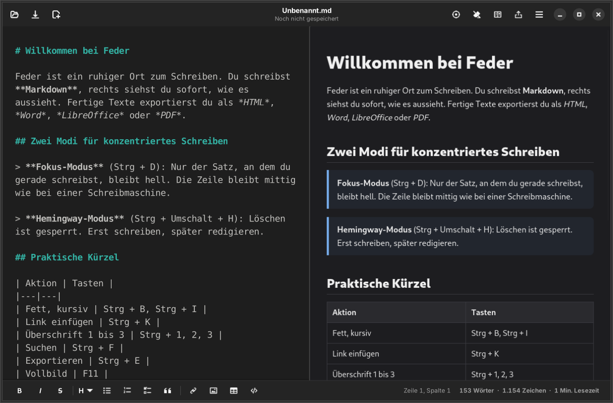
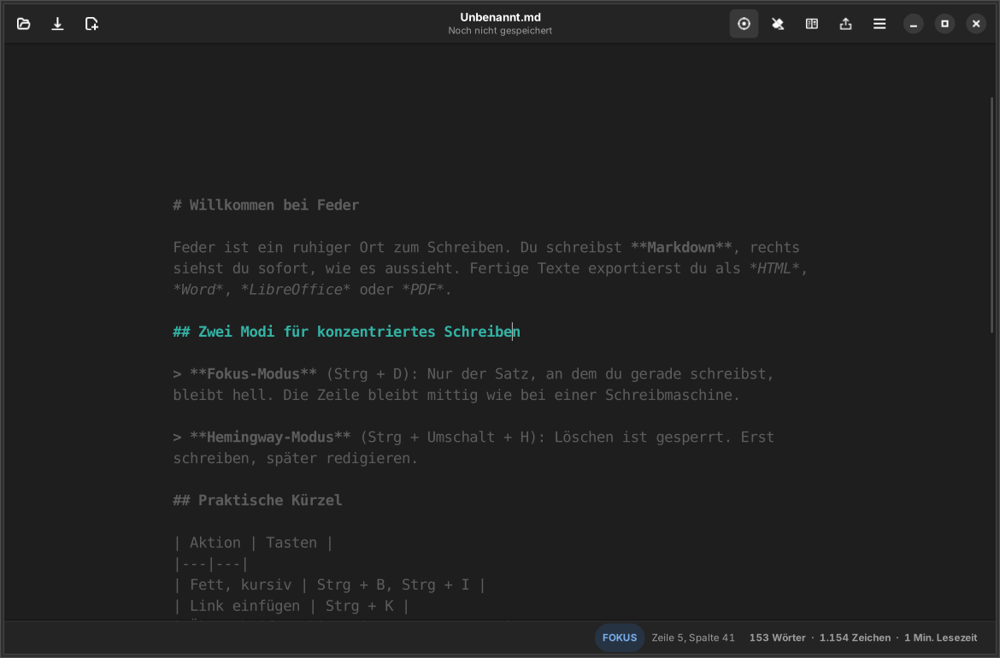
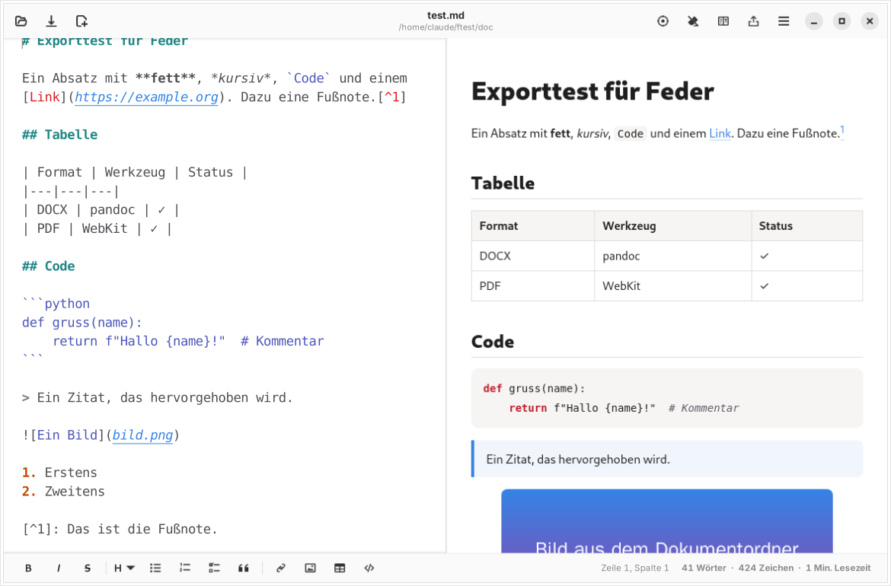
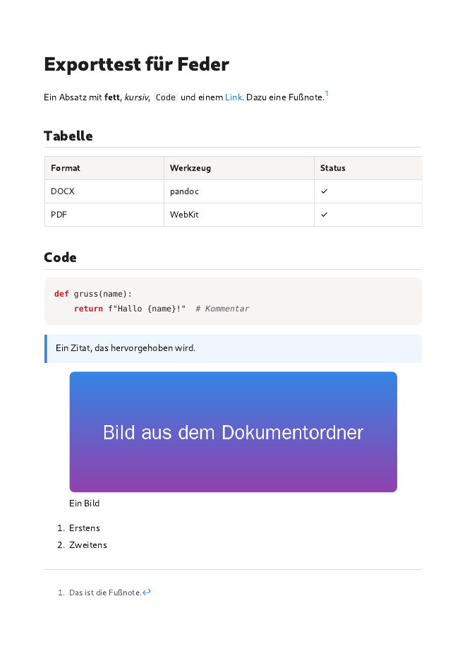

<p align="center">
  
</p>

<h1 align="center">Feder</h1>

<p align="center">
  <b>Ruhig schreiben in Markdown.</b><br>
  Live-Vorschau, Fokus-Modus, Hemingway-Modus und Export nach Word, LibreOffice, PDF und HTML,<br>
  in einer nativen GNOME-App. Ohne AUR, ohne LaTeX, auf Deutsch und Englisch.
</p>

<p align="center">
  <a href="README.md">🇬🇧 English version</a>
</p>

<p align="center">
  
  
  
  
  
  
  
</p>

<p align="center">
  
</p>

---

## Inhalt

- [Features](#features)
- [Screenshots](#screenshots)
- [Voraussetzungen](#voraussetzungen)
- [Installation](#installation)
- [Aktualisieren und Deinstallieren](#aktualisieren-und-deinstallieren)
- [Sprache](#sprache)
- [Tastenkürzel](#tastenkürzel)
- [Export im Detail](#export-im-detail)
- [Fehlerbehebung](#fehlerbehebung)
- [Projektstruktur](#projektstruktur)
- [Bekannte Grenzen](#bekannte-grenzen)
- [Lizenz](#lizenz)

## Features

### ✍️ Schreiben
- Editor mit **Markdown-Syntaxhervorhebung** (GtkSourceView), angenehm schmaler Textspalte und Monospace-Schrift
- **Listen setzen sich fort**: Enter nach `- Punkt`, `1. Punkt` oder `> Zitat` beginnt automatisch die nächste Zeile, ein leerer Punkt beendet die Liste
- **Öffnen, Speichern und Neu** direkt oben links, alles Weitere im Hauptmenü
- Alle Formatierungen auch per Tastatur, siehe [Tastenkürzel](#tastenkürzel)

### 🧰 Formatierungsleiste
Unten links, in drei Gruppen, jeder Knopf mit Tooltip und Tastenkürzel:

| Gruppe | Knöpfe |
|---|---|
| **Text** | Fett, Kursiv, Durchgestrichen |
| **Struktur** | Überschrift 1 bis 3, Aufzählung, nummerierte Liste, Aufgabenliste `- [ ]`, Zitat |
| **Einfügen** | Link, Bild (Dateiauswahl mit relativem Pfad), Tabelle (fertiges Gerüst), Codeblock |

- Listen und Zitate wirken auf **alle markierten Zeilen** und lassen sich durch erneutes Klicken wieder entfernen. Eine Aufzählung wird so mit einem Klick zur nummerierten Liste.
- Im **Fokus-Modus** und in der reinen Vorschau blendet sich die Leiste aus.
- Bei **schmalem Fenster** wird die Statistik kompakt (ein Klick wechselt zwischen Wörtern, Zeichen und Lesezeit), bei sehr schmalem Fenster weichen die Einfügen-Knöpfe und die Positionsanzeige.
- Rechts: Zeile, Spalte, **Wörter, Zeichen und Lesezeit**.

### 👁️ Live-Vorschau
- Gerenderte Ansicht direkt neben dem Text, aktualisiert sich beim Tippen
- Drei Ansichten: **nur Editor**, **geteilt** oder **nur Vorschau** (<kbd>Strg</kbd> + <kbd>P</kbd> wechselt)
- Scrollt synchron mit dem Editor
- Tabellen, Fußnoten, Codeblöcke mit Syntaxfarben, Zitate und **Bilder aus dem Dokumentordner**
- Links öffnen sich im Browser, Fußnoten springen innerhalb der Vorschau

### 🎯 Fokus-Modus
- Nur der **Satz, an dem du gerade schreibst**, bleibt hell, der Rest tritt zurück
- **Schreibmaschinen-Scrollen**: die aktuelle Zeile bleibt in der Fenstermitte
- Blendet die Vorschau aus und stellt sie danach wieder her

### 🚫 Hemingway-Modus
- **Löschen ist gesperrt**: Rücktaste, Entf, Ausschneiden, Überschreiben einer Markierung und Rückgängig
- Getreu dem Motto „erst schreiben, später redigieren“. Formatieren (Listen, Überschriften) geht weiterhin.
- Freundlicher Hinweis, wenn du es doch versuchst, und ein Abzeichen in der Statusleiste

### 📤 Export
| Format | Weg | Besonderheit |
|---|---|---|
| **Markdown** (`.md`) | direkt | dein Original, UTF-8 |
| **HTML** (`.html`) | pandoc | eigenständige Seite mit eingebettetem Stil |
| **Word** (`.docx`) | pandoc | Überschriften, Tabellen, Bilder, Fußnoten |
| **LibreOffice** (`.odt`) | pandoc | wie Word, im offenen Format |
| **PDF** (`.pdf`) | WebKit | A4, sieht aus wie die Vorschau, **kein LaTeX nötig** |

Nach jedem Export kannst du die Datei direkt aus der Benachrichtigung öffnen.

### 🌍 Zwei Sprachen
- **Deutsch und Englisch**, automatisch passend zur Systemsprache
- Umschaltbar im Hauptmenü unter **Sprache**
- Zahlen, Tastennamen und Platzhaltertexte richten sich ebenfalls nach der Sprache

### ✨ Rundherum
- Hell- und Dunkelmodus, folgt der Systemeinstellung (Editor und Vorschau)
- **Vollbild** mit <kbd>F11</kbd>, blendet alle Leisten aus
- Rückfrage bei ungespeicherten Änderungen
- „Öffnen mit Feder“ im Dateimanager für alle `.md`-Dateien
- **Einführung** mit allen Funktionen und Kürzeln, jederzeit über das Hauptmenü

## Screenshots

| Dunkelmodus | Fokus-Modus |
|:---:|:---:|
|  |  |
| **Tabellen, Code und Bilder** | **PDF-Export** |
|  |  |

## Voraussetzungen

| | |
|---|---|
| **System** | Eine aktuelle Linux-Distribution mit libadwaita 1.4 oder neuer, z. B. Arch/Manjaro, Debian 13, Ubuntu 24.04, Linux Mint 22 oder Fedora 40 und neuer. Entwickelt für GNOME, läuft aber auch unter anderen Desktops. |
| **Pakete** | Python-GObject-Bindings, GTK 4, libadwaita, GtkSourceView 5, WebKitGTK 6.0 |
| **Für den Export** | pandoc (HTML, Word, ODT und die Vorschau). PDF braucht nur WebKit. |

Alles stammt aus den offiziellen Repos deiner Distribution. Ohne pandoc läuft Feder trotzdem, die Vorschau nutzt dann `python-markdown` (falls installiert), und Word/ODT sind deaktiviert.

## Installation

**1. Abhängigkeiten installieren**, passend zu deiner Distribution:

```bash
# Arch Linux / Manjaro / EndeavourOS
sudo pacman -S --needed git python-gobject gtk4 libadwaita gtksourceview5 webkitgtk-6.0 pandoc-cli

# Debian 13+ / Ubuntu 24.04+ / Linux Mint 22+
sudo apt install git python3-gi gir1.2-gtk-4.0 gir1.2-adw-1 gir1.2-gtksource-5 gir1.2-webkit-6.0 pandoc

# Fedora 40+
sudo dnf install git python3-gobject gtk4 libadwaita gtksourceview5 webkitgtk6.0 pandoc
```

Unsicher? Starte in Schritt 2 einfach `./install.sh`: Es erkennt deine Distribution und nennt den passenden Befehl, falls etwas fehlt.

**2. Repository holen und installieren:**

```bash
git clone https://github.com/netlusche/Feder.git
cd Feder
./install.sh
```

**Feder** erscheint jetzt im App-Menü. Beim ersten Start wartet ein kurzer Willkommenstext mit allen Kürzeln. Du findest ihn jederzeit wieder unter Hauptmenü → **Einführung anzeigen**.

<details>
<summary><b>Was macht <code>install.sh</code> genau?</b></summary>

Der Installer erkennt Distribution und Sprache, prüft die Python-Bindings und die libadwaita-Version und legt nur Dateien in deinem Home-Verzeichnis an:

| Ziel | Inhalt |
|---|---|
| `~/.local/share/feder/` | Programm (`feder.py`), Symbole, Übersetzungen und Datendateien |
| `~/.local/bin/feder` | Start aus dem Terminal, z. B. `feder notizen.md` |
| `~/.local/share/applications/io.github.netlusche.Feder.desktop` | App-Menü und „Öffnen mit“ für Markdown, auf Deutsch und Englisch |
| `~/.local/share/icons/hicolor/scalable/apps/` | App-Icon |

Kein `sudo`, keine systemweiten Änderungen.
</details>

<details>
<summary><b>Ohne Installation ausprobieren</b></summary>

```bash
python3 feder.py [DATEI.md]
```
</details>

## Aktualisieren und Deinstallieren

```bash
# Aktualisieren
cd Feder
git pull
./install.sh

# Deinstallieren
./install.sh --uninstall
```

Einstellungen (Sprache, Schriftgröße, Ansicht, Fenstergröße, letzter Ordner) liegen in `~/.config/feder/config.json`.

## Sprache

Feder spricht **Deutsch und Englisch** und richtet sich nach deiner Systemsprache: Deutsch, wenn dein System auf Deutsch steht, sonst Englisch. Zum Umstellen öffnest du Hauptmenü → **Sprache** und wählst *Systemsprache*, *Deutsch* oder *English*. Die Änderung wirkt nach einem Neustart von Feder.

**Eine weitere Sprache beisteuern?** Die Übersetzungen laufen über gettext. Kopiere `po/de.po` z. B. nach `po/fr.po`, übersetze sie, lege `data/welcome.fr.md` an, starte `tools/update-translations.sh` (braucht die gettext-Werkzeuge) und öffne einen Pull Request.

## Tastenkürzel

| Aktion | Tasten |
|---|---|
| Neu / Öffnen / Speichern | <kbd>Strg</kbd>+<kbd>N</kbd> / <kbd>Strg</kbd>+<kbd>O</kbd> / <kbd>Strg</kbd>+<kbd>S</kbd> |
| Speichern unter | <kbd>Strg</kbd>+<kbd>Umschalt</kbd>+<kbd>S</kbd> |
| Exportieren | <kbd>Strg</kbd>+<kbd>E</kbd> |
| Ansicht wechseln (Editor, geteilt, Vorschau) | <kbd>Strg</kbd>+<kbd>P</kbd> |
| Fokus-Modus | <kbd>Strg</kbd>+<kbd>D</kbd> |
| Hemingway-Modus | <kbd>Strg</kbd>+<kbd>Umschalt</kbd>+<kbd>H</kbd> |
| Fett / Kursiv / Code | <kbd>Strg</kbd>+<kbd>B</kbd> / <kbd>Strg</kbd>+<kbd>I</kbd> / <kbd>Strg</kbd>+<kbd>Umschalt</kbd>+<kbd>C</kbd> |
| Durchgestrichen | <kbd>Strg</kbd>+<kbd>Umschalt</kbd>+<kbd>X</kbd> |
| Aufzählung / nummerierte Liste | <kbd>Strg</kbd>+<kbd>Umschalt</kbd>+<kbd>L</kbd> / <kbd>N</kbd> |
| Aufgabenliste / Zitat | <kbd>Strg</kbd>+<kbd>Umschalt</kbd>+<kbd>O</kbd> / <kbd>Q</kbd> |
| Link einfügen | <kbd>Strg</kbd>+<kbd>K</kbd> |
| Bild / Tabelle einfügen | <kbd>Strg</kbd>+<kbd>Umschalt</kbd>+<kbd>I</kbd> / <kbd>T</kbd> |
| Codeblock | <kbd>Strg</kbd>+<kbd>Alt</kbd>+<kbd>C</kbd> |
| Überschrift 1 bis 3 (erneut drücken entfernt sie) | <kbd>Strg</kbd>+<kbd>1</kbd> / <kbd>2</kbd> / <kbd>3</kbd> |
| Suchen | <kbd>Strg</kbd>+<kbd>F</kbd> |
| Schrift größer / kleiner / normal | <kbd>Strg</kbd>+<kbd>+</kbd> / <kbd>Strg</kbd>+<kbd>−</kbd> / <kbd>Strg</kbd>+<kbd>0</kbd> |
| Vollbild an / aus | <kbd>F11</kbd> (raus auch mit <kbd>Esc</kbd>) |
| Beenden | <kbd>Strg</kbd>+<kbd>Q</kbd> |

## Export im Detail

- **Bilder** mit relativem Pfad (``) werden aus dem Ordner der Markdown-Datei geladen, sowohl in der Vorschau als auch in Word, ODT und PDF. Speichere neue Dokumente also einmal, bevor du Bilder einbindest.
- **HTML** ist eine einzelne Datei mit eingebettetem Stil. Bilder bleiben verlinkt, lege sie deshalb neben die HTML-Datei.
- **PDF** entsteht über die Druckfunktion von WebKit, A4 mit 20 mm Rand. Das Ergebnis entspricht der hellen Vorschau, auch wenn du im Dunkelmodus arbeitest.
- **Word und ODT** nutzen die Standardvorlagen von pandoc. Eigene Formatvorlagen sind für eine spätere Version geplant.
- Als **Dateiname** schlägt Feder die erste Überschrift oder den Dateinamen vor.

## Fehlerbehebung

<details>
<summary><b>„Für Word und ODT wird pandoc benötigt“</b></summary>

Installiere pandoc aus deiner Distribution, Feder nennt den passenden Befehl direkt in der Meldung:

```bash
sudo pacman -S --needed pandoc-cli   # Arch / Manjaro
sudo apt install pandoc              # Debian / Ubuntu / Mint
sudo dnf install pandoc              # Fedora
```
</details>

<details>
<summary><b>Bilder erscheinen nicht in der Vorschau</b></summary>

Relative Pfade beziehen sich auf den Ordner der Datei. Bei einem neuen, noch nicht gespeicherten Dokument gibt es diesen Ordner noch nicht: einmal speichern, dann klappt es.
</details>

<details>
<summary><b>Installer meldet fehlende Pakete oder eine zu alte libadwaita</b></summary>

Führe den Befehl aus, den der Installer nennt, und starte danach `./install.sh` erneut. Feder braucht libadwaita 1.4 oder neuer, die ältere Versionen wie Ubuntu 22.04 oder Linux Mint 21 nicht mitbringen.
</details>

<details>
<summary><b>Feder zeigt die falsche Sprache</b></summary>

Feder richtet sich nach `LANGUAGE`, `LC_ALL`, `LC_MESSAGES` und `LANG`. Zum Überschreiben: Hauptmenü → **Sprache**, danach Feder neu starten.
</details>

## Projektstruktur

```
Feder/
├── feder.py                          # die komplette App
├── install.sh                        # Installer / Deinstaller (nur ~/.local)
├── io.github.netlusche.Feder.svg     # App-Icon
├── data/
│   ├── preview.css                   # Stil für Vorschau und Export
│   └── welcome.en.md, welcome.de.md  # Einführungstext je Sprache
├── po/                               # Übersetzungsquellen (gettext)
├── locale/                           # kompilierte Übersetzungen
├── tools/update-translations.sh      # Entwicklerwerkzeug für Übersetzungen
├── icons/hicolor/scalable/actions/   # eigene Symbolic-Icons
├── docs/screenshots/                 # Bilder für die READMEs (en, de)
├── CHANGELOG.md
├── LICENSE
├── README.md
└── README.de.md
```

## Bekannte Grenzen

- **Keine Rechtschreibprüfung** bisher.
- Die Scroll-Synchronisation ist proportional, bei sehr unterschiedlich langen Abschnitten (z. B. großen Bildern) liegt die Vorschau leicht daneben.
- Beim Fokus-Modus erkennt Feder Satzenden an `.`, `!`, `?` und `…`. Abkürzungen wie „z. B.“ zählen dabei als Satzende.
- Getestet mit libadwaita 1.5, GTK 4.14, WebKitGTK 2.52 und pandoc 3.1 unter Ubuntu 24.04, ausgelegt für libadwaita 1.4 und neuer. Die Fedora-Paketnamen sind auf Fedora selbst noch nicht getestet.

## Lizenz

[MIT](LICENSE). Mach damit, was du möchtest.

<p align="center"><sub>Gebaut mit GTK 4, libadwaita, GtkSourceView, WebKitGTK und pandoc.</sub></p>
