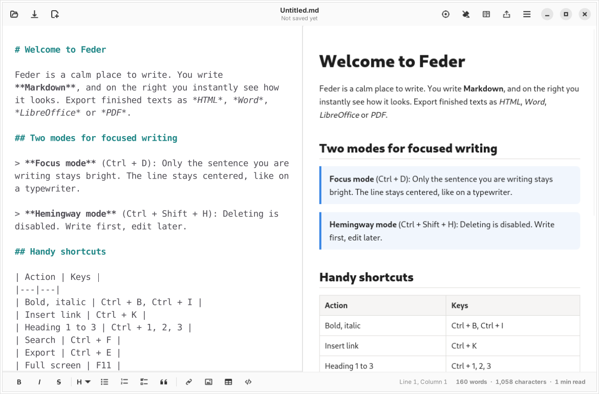
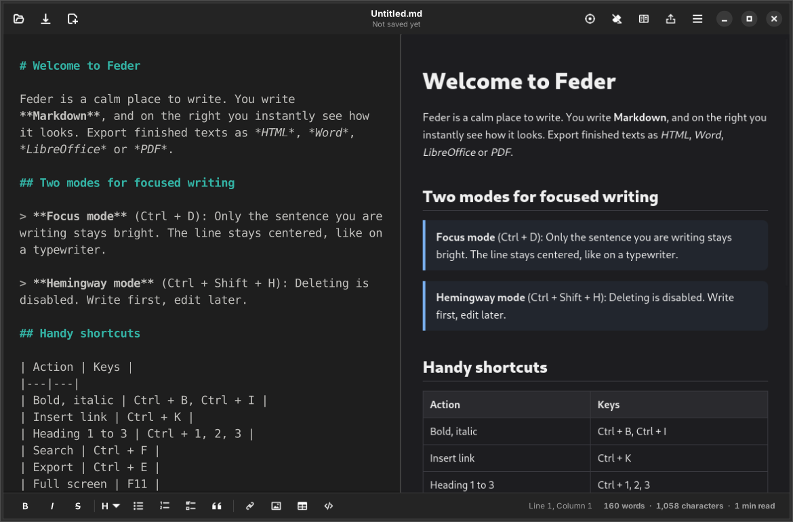
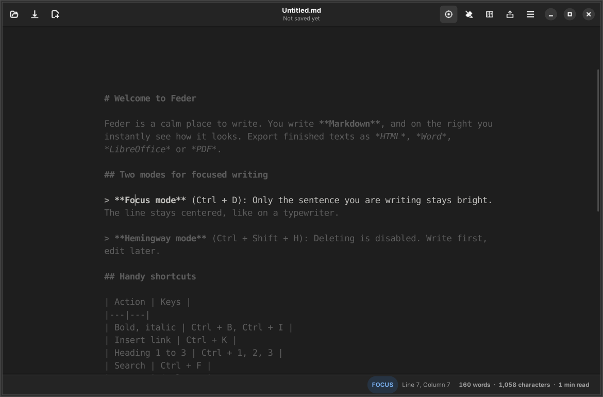
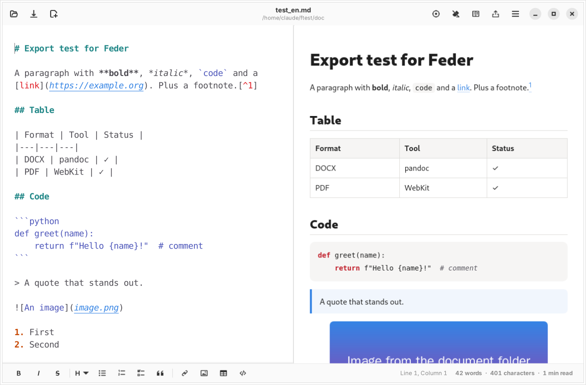
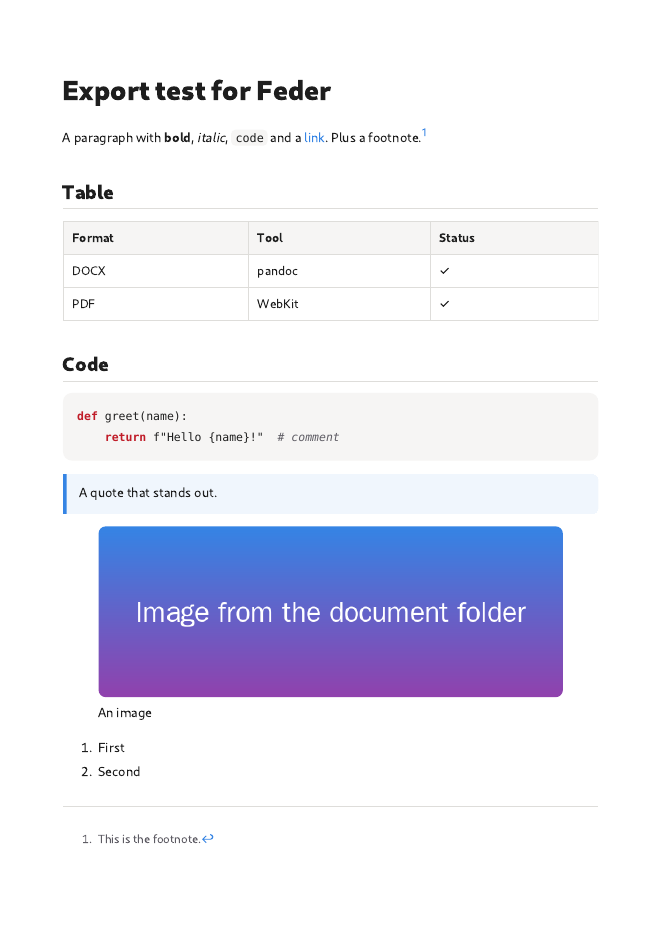

<p align="center">
  
</p>

<h1 align="center">Feder</h1>

<p align="center">
  <b>Calm writing in Markdown.</b><br>
  Live preview, focus mode, Hemingway mode and export to Word, LibreOffice, PDF and HTML,<br>
  in a native GNOME app. No AUR, no LaTeX, English and German.
</p>

<p align="center">
  <a href="README.de.md">🇩🇪 Deutsche Version</a>
</p>

<p align="center">
  
  
  
  
  
  
  
</p>

<p align="center">
  
</p>

---

## Contents

- [Features](#features)
- [Screenshots](#screenshots)
- [Requirements](#requirements)
- [Installation](#installation)
- [Updating and uninstalling](#updating-and-uninstalling)
- [Language](#language)
- [Keyboard shortcuts](#keyboard-shortcuts)
- [Export in detail](#export-in-detail)
- [Troubleshooting](#troubleshooting)
- [Project structure](#project-structure)
- [Known limitations](#known-limitations)
- [License](#license)

## Features

### ✍️ Writing
- Editor with **Markdown syntax highlighting** (GtkSourceView), a pleasantly narrow text column and a monospace font
- **Lists continue automatically**: pressing Enter after `- item`, `1. item` or `> quote` starts the next line, an empty item ends the list
- **Open, Save and New** right at the top left, everything else in the main menu
- All formatting is also available from the keyboard, see [Keyboard shortcuts](#keyboard-shortcuts)

### 🧰 Formatting bar
At the bottom left, in three groups, every button with a tooltip showing its shortcut:

| Group | Buttons |
|---|---|
| **Text** | Bold, italic, strikethrough |
| **Structure** | Heading 1 to 3, bulleted list, numbered list, task list `- [ ]`, quote |
| **Insert** | Link, image (file chooser with relative path), table (ready-made scaffold), code block |

- Lists and quotes apply to **all selected lines** and can be removed by clicking again. One click turns a bulleted list into a numbered one.
- The bar hides itself in **focus mode** and in preview-only view.
- In a **narrow window** the statistics become compact (click to switch between words, characters and reading time). In a very narrow window the insert buttons and the position display make room.
- On the right: line, column, **words, characters and reading time**.

### 👁️ Live preview
- Rendered view right next to the text, updated as you type
- Three views: **editor only**, **split** or **preview only** (<kbd>Ctrl</kbd> + <kbd>P</kbd> switches)
- Scrolls in sync with the editor
- Tables, footnotes, code blocks with syntax colors, quotes and **images from the document folder**
- Links open in your browser, footnotes jump within the preview

### 🎯 Focus mode
- Only the **sentence you are writing** stays bright, the rest steps back
- **Typewriter scrolling**: the current line stays in the middle of the window
- Hides the preview and restores it afterwards

### 🚫 Hemingway mode
- **Deleting is disabled**: Backspace, Delete, cut, overwriting a selection and undo
- In the spirit of “write first, edit later”. Formatting (lists, headings) still works.
- A friendly hint if you try anyway, plus a badge in the status bar

### 📤 Export
| Format | Via | Notes |
|---|---|---|
| **Markdown** (`.md`) | direct | your original, UTF-8 |
| **HTML** (`.html`) | pandoc | standalone page with embedded style |
| **Word** (`.docx`) | pandoc | headings, tables, images, footnotes |
| **LibreOffice** (`.odt`) | pandoc | like Word, in the open format |
| **PDF** (`.pdf`) | WebKit | A4, looks like the preview, **no LaTeX needed** |

After every export you can open the file straight from the notification.

### 🌍 Two languages
- **English and German**, following your system language automatically
- Can be switched in the main menu under **Language**
- Numbers, shortcut names and placeholder texts follow the language too

### ✨ And also
- Light and dark mode, follows the system setting (editor and preview)
- **Full screen** with <kbd>F11</kbd>, hides all bars
- Asks before discarding unsaved changes
- “Open With Feder” in the file manager for all `.md` files
- **Introduction** with all features and shortcuts, available any time from the main menu

## Screenshots

| Dark mode | Focus mode |
|:---:|:---:|
|  |  |
| **Tables, code and images** | **PDF export** |
|  |  |

## Requirements

| | |
|---|---|
| **System** | A current Linux distribution with libadwaita 1.4 or newer, for example Arch/Manjaro, Debian 13, Ubuntu 24.04, Linux Mint 22 or Fedora 40 and newer. Built for GNOME, works on other desktops too. |
| **Packages** | Python GObject bindings, GTK 4, libadwaita, GtkSourceView 5, WebKitGTK 6.0 |
| **For export** | pandoc (HTML, Word, ODT and the preview). PDF only needs WebKit. |

Everything comes from your distribution’s official repositories. Without pandoc Feder still runs: the preview then uses `python-markdown` (if installed) and Word/ODT export is disabled.

## Installation

**1. Install the dependencies** for your distribution:

```bash
# Arch Linux / Manjaro / EndeavourOS
sudo pacman -S --needed git python-gobject gtk4 libadwaita gtksourceview5 webkitgtk-6.0 pandoc-cli

# Debian 13+ / Ubuntu 24.04+ / Linux Mint 22+
sudo apt install git python3-gi gir1.2-gtk-4.0 gir1.2-adw-1 gir1.2-gtksource-5 gir1.2-webkit-6.0 pandoc

# Fedora 40+
sudo dnf install git python3-gobject gtk4 libadwaita gtksourceview5 webkitgtk6.0 pandoc
```

Not sure? Just run `./install.sh` in step 2: it detects your distribution and prints the matching command if anything is missing.

**2. Get the repository and install:**

```bash
git clone https://github.com/netlusche/Feder.git
cd Feder
./install.sh
```

**Feder** now appears in your app menu. On first start a short welcome text explains everything. You can open it again at any time via main menu → **Show Introduction**.

<details>
<summary><b>What exactly does <code>install.sh</code> do?</b></summary>

The installer detects your distribution and language, checks the Python bindings and the libadwaita version, and only creates files in your home directory:

| Target | Contents |
|---|---|
| `~/.local/share/feder/` | Program (`feder.py`), icons, translations and data files |
| `~/.local/bin/feder` | Start from a terminal, e.g. `feder notes.md` |
| `~/.local/share/applications/io.github.netlusche.Feder.desktop` | App menu entry and “Open With” for Markdown, in English and German |
| `~/.local/share/icons/hicolor/scalable/apps/` | App icon |

No `sudo`, no system-wide changes.
</details>

<details>
<summary><b>Try without installing</b></summary>

```bash
python3 feder.py [FILE.md]
```
</details>

## Updating and uninstalling

```bash
# Update
cd Feder
git pull
./install.sh

# Uninstall
./install.sh --uninstall
```

Settings (language, font size, view, window size, last folder) are stored in `~/.config/feder/config.json`.

## Language

Feder speaks **English and German** and follows your system language: German if your system is set to German, English otherwise. To choose manually, open the main menu → **Language** and pick *System Default*, *Deutsch* or *English*. The change takes effect after restarting Feder.

**Want to add a language?** Translations use gettext. Copy `po/de.po` to e.g. `po/fr.po`, translate it, add a `data/welcome.fr.md`, run `tools/update-translations.sh` (needs the gettext tools) and open a pull request.

## Keyboard shortcuts

| Action | Keys |
|---|---|
| New / Open / Save | <kbd>Ctrl</kbd>+<kbd>N</kbd> / <kbd>Ctrl</kbd>+<kbd>O</kbd> / <kbd>Ctrl</kbd>+<kbd>S</kbd> |
| Save as | <kbd>Ctrl</kbd>+<kbd>Shift</kbd>+<kbd>S</kbd> |
| Export | <kbd>Ctrl</kbd>+<kbd>E</kbd> |
| Switch view (editor, split, preview) | <kbd>Ctrl</kbd>+<kbd>P</kbd> |
| Focus mode | <kbd>Ctrl</kbd>+<kbd>D</kbd> |
| Hemingway mode | <kbd>Ctrl</kbd>+<kbd>Shift</kbd>+<kbd>H</kbd> |
| Bold / Italic / Code | <kbd>Ctrl</kbd>+<kbd>B</kbd> / <kbd>Ctrl</kbd>+<kbd>I</kbd> / <kbd>Ctrl</kbd>+<kbd>Shift</kbd>+<kbd>C</kbd> |
| Strikethrough | <kbd>Ctrl</kbd>+<kbd>Shift</kbd>+<kbd>X</kbd> |
| Bulleted / numbered list | <kbd>Ctrl</kbd>+<kbd>Shift</kbd>+<kbd>L</kbd> / <kbd>N</kbd> |
| Task list / quote | <kbd>Ctrl</kbd>+<kbd>Shift</kbd>+<kbd>O</kbd> / <kbd>Q</kbd> |
| Insert link | <kbd>Ctrl</kbd>+<kbd>K</kbd> |
| Insert image / table | <kbd>Ctrl</kbd>+<kbd>Shift</kbd>+<kbd>I</kbd> / <kbd>T</kbd> |
| Code block | <kbd>Ctrl</kbd>+<kbd>Alt</kbd>+<kbd>C</kbd> |
| Heading 1 to 3 (press again to remove) | <kbd>Ctrl</kbd>+<kbd>1</kbd> / <kbd>2</kbd> / <kbd>3</kbd> |
| Search | <kbd>Ctrl</kbd>+<kbd>F</kbd> |
| Font larger / smaller / normal | <kbd>Ctrl</kbd>+<kbd>+</kbd> / <kbd>Ctrl</kbd>+<kbd>−</kbd> / <kbd>Ctrl</kbd>+<kbd>0</kbd> |
| Full screen on / off | <kbd>F11</kbd> (leave also with <kbd>Esc</kbd>) |
| Quit | <kbd>Ctrl</kbd>+<kbd>Q</kbd> |

## Export in detail

- **Images** with a relative path (``) are loaded from the folder of the Markdown file, in the preview as well as in Word, ODT and PDF. So save new documents once before adding images.
- **HTML** is a single file with embedded style. Images stay linked, so keep them next to the HTML file.
- **PDF** is created through WebKit’s print function, A4 with 20 mm margins. It matches the light preview, even if you work in dark mode.
- **Word and ODT** use pandoc’s default templates. Custom templates are planned for a later version.
- As a **file name** Feder suggests the first heading or the document’s file name.

## Troubleshooting

<details>
<summary><b>“Word and ODT export needs pandoc”</b></summary>

Install pandoc from your distribution, Feder shows the matching command in the message:

```bash
sudo pacman -S --needed pandoc-cli   # Arch / Manjaro
sudo apt install pandoc              # Debian / Ubuntu / Mint
sudo dnf install pandoc              # Fedora
```
</details>

<details>
<summary><b>Images don’t show in the preview</b></summary>

Relative paths refer to the folder of the file. A new, unsaved document has no folder yet: save it once and it works.
</details>

<details>
<summary><b>The installer reports missing packages or an old libadwaita</b></summary>

Run the command the installer prints, then start `./install.sh` again. Feder needs libadwaita 1.4 or newer, which older releases such as Ubuntu 22.04 or Linux Mint 21 don’t provide.
</details>

<details>
<summary><b>Feder shows the wrong language</b></summary>

Feder follows `LANGUAGE`, `LC_ALL`, `LC_MESSAGES` and `LANG`. To override, use main menu → **Language** and restart Feder.
</details>

## Project structure

```
Feder/
├── feder.py                          # the whole app
├── install.sh                        # installer / uninstaller (~/.local only)
├── io.github.netlusche.Feder.svg     # app icon
├── data/
│   ├── preview.css                   # style for preview and export
│   └── welcome.en.md, welcome.de.md  # introduction text per language
├── po/                               # translation sources (gettext)
├── locale/                           # compiled translations
├── tools/update-translations.sh      # developer tool for translations
├── icons/hicolor/scalable/actions/   # custom symbolic icons
├── docs/screenshots/                 # images for the READMEs (en, de)
├── CHANGELOG.md
├── LICENSE
├── README.md
└── README.de.md
```

## Known limitations

- **No spell checking** yet.
- Scroll sync is proportional, so with very uneven sections (e.g. large images) the preview can be slightly off.
- Focus mode detects sentence ends at `.`, `!`, `?` and `…`. Abbreviations such as “e.g.” count as sentence ends.
- Tested with libadwaita 1.5, GTK 4.14, WebKitGTK 2.52 and pandoc 3.1 on Ubuntu 24.04, designed for libadwaita 1.4 and newer. The Fedora package names have not been tested on Fedora itself yet.

## License

[MIT](LICENSE). Do whatever you like with it.

<p align="center"><sub>Built with GTK 4, libadwaita, GtkSourceView, WebKitGTK and pandoc.</sub></p>
